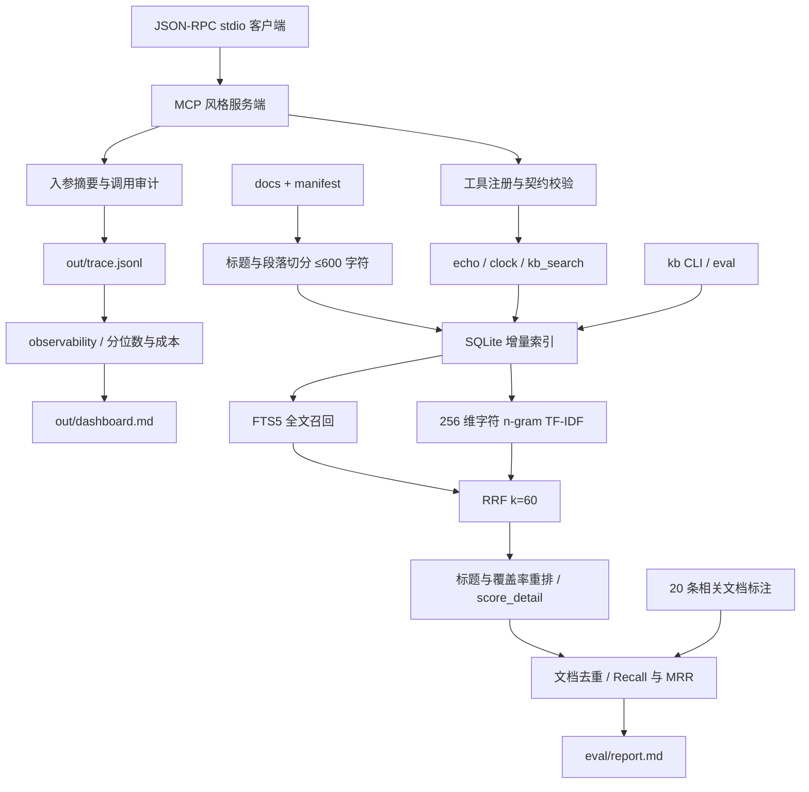

# Agent-Toolgate

[](https://github.com/iquil-liu/agent-toolgate/actions/workflows/ci.yml)

一个可离线运行的 Python 工具调用与知识检索作品集：工具契约、JSON-RPC stdio、审计、FTS5 + 字符向量混合检索、可解释重排、评测和调用观测。
语料为完全自造的 20 篇通用技术文档，不含真实组织、域名、凭据。主路径仅使用标准库，不联网、不下载模型。

## 结果速览

同一套 20 条人工标注查询、同一份语料，只切换检索模式：

| 指标 | baseline（仅字面 FTS） | hybrid（本文实现） |
|---|---:|---:|
| Recall@1 | 0.55 | **0.80** |
| Recall@3 | 0.55 | **0.90** |
| Recall@5 | 0.55 | **0.95** |
| MRR | 0.5500 | **0.8625** |

- **62 条单元测试**全绿；`python3 -S`（禁用 site-packages）下同样全绿，证明主路径零外部依赖
- **九项验收**逐条带命令与原始输出：见 [out/acceptance.md](out/acceptance.md)
- 20 篇自造语料 / 80 块索引；每次工具调用落审计 trace（含 token 估算标记与耗时）
- 断网、无 pip 环境下可完整复现

## 快速开始

环境：Python 3.11+，其 sqlite3 编译时需启用 FTS5；无需 pip install。命令在仓库根目录执行。

```sh
python3 -m src.kb.cli rebuild
python3 -m src.mcp_server --demo
python3 -m src.kb.cli stats
python3 -m src.kb.cli search "混合检索 重排"
python3 eval/run_eval.py
python3 -m src.observability
python3 -m unittest discover -s tests -v
python3 scripts/mcp_client_probe.py
```

一条命令跑演示：`python3 -m src.mcp_server --demo`，输出 initialize、tools/list 和 echo、kb_search 的 tools/call 结果（默认查询「混合检索 重排」，Top3），同时追加调用审计。
一条命令生成双模式评测：`python3 eval/run_eval.py`，自动增量 rebuild，输出指标并生成 [评测报告](eval/report.md) 与逐条证据 `out/eval-results.json`。
执行 `python3 -m src.observability` 后打开 [观测面板](out/dashboard.md)。缺少日志时先跑 demo；面板不会伪造调用样本。

```sh
# 分别输出所选模式指标；每次都重新评测两模式，确保报告始终为同版本的新鲜对比
python3 eval/run_eval.py --baseline
python3 eval/run_eval.py --hybrid
python3 eval/run_eval.py --baseline --hybrid
# 验证不依赖 site-packages
python3 -S -m src.mcp_server --demo
python3 -S eval/run_eval.py
```

`--baseline` / `--hybrid` 选择控制台显示的模式；不传开关或同时传两者则显示全部指标。为避免旧结果混入对比，每次运行均更新双模式报告及逐条证据。

## 架构



`src/registry.py` 实现工具注册和 JSON Schema 子集，`src/mcp_server.py` 实现三种 JSON-RPC 方法及错误恢复。
`kb_search(query, limit=3)` 直接调用 CLI 同一个 `KnowledgeIndex.search(..., mode="hybrid")`，返回 doc_id、heading_path、score、score_detail；空索引首次调用自动 rebuild，后续更新语料仍显式 rebuild。
这是 MCP 风格演示服务，不声称完成 MCP 全协议兼容或通用 Workflow 执行器。

## 检索与评测口径

- 切分保留 doc_id、heading_path、block_index；600 字符为正文上限，标题路径独立保存，代码围栏不误识别为标题。
- FTS 索引为中文加入字符片段，查询提取安全字面词项，以 OR 匹配；baseline 只走既有 FTS，不人为降低其召回能力。
- 向量为字符 2/3-gram 稳定哈希、256 维、TF-IDF 加权及 L2 归一化。这是**离线基线，生产可替换为 bge-m3**，不具备完整语义理解能力。
- hybrid 使用两路各最多 100 块候选，RRF `sum(1/(60+rank))`；最终分 = RRF + `0.04 × title_hit + 0.02 × term_coverage`。score_detail 中各项可复算；无字面词/二元字符重叠的碰撞候选被剔除。
- 评测使用同一 20 条人工标注查询，覆盖全部文档。保留完整候选后按文档首次出现去重；Recall@1/3/5 为相关文档覆盖率宏平均，MRR 为首个正确文档排名倒数宏平均，未命中为零。
- 平均延迟是单进程每查询一次的检索及文档去重耗时，不包含构建索引；不是并发压测或稳定性能承诺。报告提供语料/用例/实现指纹和逐条排名。
- hybrid Recall@5 低于 **0.80** 时评测以非零退出；双模式评测同时要求 hybrid 高于 baseline。本轮沿用原参数，未调整切分、RRF、标注或验收阈值。
- 自造查询与语料的开发集结果只能说明本演示覆盖情况；生产决策还需要独立留出集、无答案请求、同义改写及更大语料。

## 观测与成本估算

审计仅记录 trace_id、工具、入参 SHA-256 摘要、状态、耗时、错误码及 prompt_tokens / completion_tokens / usage_estimated，不落原始参数或响应。
面板按文件全部调用计算总数、成功率、错误码分布、P50/P95（排序后位置 `(n-1)×q` 线性插值）。
坏行、非法耗时或 token 值会明确报错并以非零退出，避免静默丢样本；空文件不虚构成功率和分位数。

计价输入是每条 JSONL 的可选 `prompt_tokens` 和 `completion_tokens` 非负整数；按 `task_id` 聚合任务成本，未提供时每个 trace_id 视为一次任务。
默认输入 **1 USD / 百万 tokens**、输出 **2 USD / 百万 tokens** 都是占位单价，必须替换为实际使用模型的计费配置。
成本 = `(prompt_tokens × 输入单价 + completion_tokens × 输出单价) / 1_000_000`，失败调用也计入。

```sh
python3 -m src.observability --trace out/trace.jsonl --output out/dashboard.md --prompt-price 1 --completion-price 2
```

本地工具没有模型实测用量：分别将入参及工具结果/错误以 sort_keys=True、ensure_ascii=False、separators=(",", ":") 序列化，按 Unicode 字符数 / 4 向上取整估算 tokens，始终标记 usage_estimated=true。该代理量包含 JSON 结构字符，不含系统提示与协议封装，不等同于 tokenizer 计量或实际账单。
面板区分估算、明确实测与未标来源，展示已知成本小计、估算成本和缺失数。旧审计原样保留；存在缺失时完整总成本与平均任务成本仍未知，不能把缺失当零。未来模型接入需采集供应商真实用量并明确标记 usage_estimated=false。
测试使用临时虚构用量验证非零成本、失败计费和任务聚合，不向真实 trace 混入测试事件。

## 设计取舍

1. **标准库与 SQLite 优先**：免安装、离线可演示；代价是没有网络服务扩展能力，依赖宿主 Python 的 FTS5 支持。
2. **哈希字符向量替代模型下载**：可跨进程复现并补充中文局部匹配；代价是碰撞、同义表达召回能力有限。
3. **RRF 与透明规则重排**：融合不同比例的排名并允许手算解释；代价是无法替代训练后的语义重排模型。
4. **保存特征计数并增量重建**：未变文档不再切分，变更后统一刷新 IDF；代价是查询仍需逐块转换向量，大规模延迟线性增长。
5. **缺失用量明确标为未知**：成本结果可追溯，避免把观测盲区误报为免费；代价是历史日志无法给出完整账单估算。

## 后续升级与局限

生产化优先接入供应商真实用量采集和任务关联，再替换 bge-m3 / ANN / 语义重排，并用独立评测集验证质量、延迟与成本。
随后增加身份认证、实际授权门禁、调用预算、超时取消、日志轮转与脱敏审查；本项目目前仅提供相关自造文档及局部基础能力，没有实现这些完整生产机制。
stdio、追加 JSONL 和单机 SQLite 适用于演示；多进程持久化、日志窗口及高并发仍需工程化设计。
当前仓库已公开于 `github.com/iquil-liu/agent-toolgate`，CI 覆盖索引重建、单元测试、零依赖复跑、工具演示、检索评测与观测面板六个步骤。MCP 服务是风格最小实现，尚未在真实 MCP 客户端（Claude Desktop / Cursor）实测接入，配置样例见 `MCP-CLIENTS.md`，标注为待人工验证。
